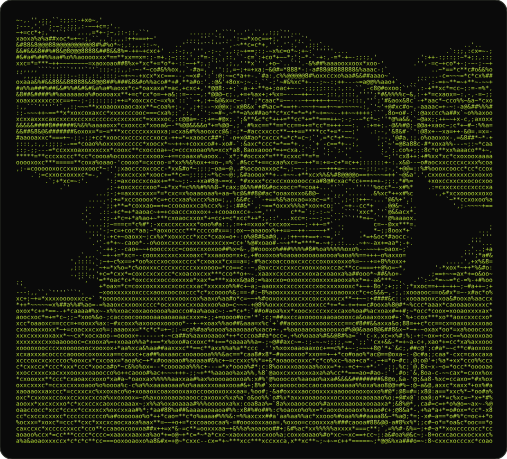

`earn@palexus:~$ whoami`

# Local-First AI Engineer.

**IT repair tech turned indie dev.** Rust and Python tooling backed by models that run on-device — no cloud, no telemetry, no compromise.

`● Offline · Zero telemetry · Perth, WA`

 

 

| PUBLIC REPOS | MODELS ON-DEVICE | LANGUAGES IN STACK | CLOUD DEPENDENCIES |
|:---:|:---:|:---:|:---:|
| **19** | **4+** | **5** | **0** |
| 14 active · 5 archived | 2 more planned | Rust · TS · Python · PS · Bash | by design |

---

## `// featured` — PalexusOS &nbsp;`ACTIVE`

**The AI-Native Linux Workstation.** One brain, all models, zero cloud friction. An Arch-based workstation on the CachyOS BORE kernel that runs AI models directly on your own hardware — paired with **palexus-brain**, a local gateway that wires 15 AI coding tools to one canonical config.

`Arch Linux` `CachyOS BORE` `Ollama` `palexus-brain`

**[view repository →](https://github.com/earnerbaymalay/palexusOS)** &nbsp;·&nbsp; **[palexus-brain →](https://github.com/earnerbaymalay/palexus-brain)**

---

## `// projects`

| Repo | |
|---|---|
| [**palexusOS**](https://github.com/earnerbaymalay/palexusOS) | AI-native Arch Linux workstation |
| [**palexus-brain**](https://github.com/earnerbaymalay/palexus-brain) | Canonical AI brain and local gateway |
| [**promptpack-marketplace**](https://github.com/earnerbaymalay/promptpack-marketplace) | Local-first prompt template marketplace, A/B eval, Ed25519-signed packs, Ollama eval runner |
| [**promptpack-index**](https://github.com/earnerbaymalay/promptpack-index) | |
| [**hwcert**](https://github.com/earnerbaymalay/hwcert) · [**hwcert-verifier**](https://github.com/earnerbaymalay/hwcert-verifier) | |
| [**cyph3rchat**](https://github.com/earnerbaymalay/cyph3rchat) | End-to-end encrypted communication client |
| [**shadow-check**](https://github.com/earnerbaymalay/shadow-check) | Passive counter-surveillance detection |
| [**meshtouch**](https://github.com/earnerbaymalay/meshtouch) | Encrypted messaging over a hybrid relay network |
| [**sherlock-suite**](https://github.com/earnerbaymalay/sherlock-suite) | Defensive OSINT, attack surface management |
| [**llm-skill-library**](https://github.com/earnerbaymalay/llm-skill-library) | Skills for Claude, Claude Code and Google LLM IDEs |
| [**standards**](https://github.com/earnerbaymalay/standards) | |

Full list with live data on **[earnerbaymalay.github.io](https://earnerbaymalay.github.io/#projects)**.

---

## `// ollama list`

| Model | Quant | Size | Use | Device |
|---|---|---|---|---|
| qwen2.5-coder:1.5b | Q4_K_M | 1.1 GB | Code gen, eval judge | Surface Pro 9 |
| qwen2.5:3b | Q4_K_M | 2.0 GB | Reasoning, prompt eval | Surface Pro 9 |
| llama3.2-3b | Q4_K_M | 2.0 GB | Instruction following | Surface Pro 9 |
| dolphin-phi | Q4_K_M | 1.8 GB | Security work | Surface Pro 9 |
| qwen2.5-coder:7b | Q4_K_M | 4.4 GB | Heavy code tasks | Desktop · planned |
| llama3.1-8b | Q4_K_M | 4.7 GB | Long context, RAG | Desktop · planned |

---

## `// stack`

`Rust` `TypeScript` `Python` `PowerShell` `Bash` · `Tauri 2` `Vite` `React` `Next.js` `Electron` · `Ollama` `llama.cpp` `candle` `ONNX Runtime` `tokenizers` · `GitHub Actions` `Docker` `Nix` `WSL2` `Termux` `SQLite` `libsql` `PostgreSQL` `Redis` `Git` `Obsidian` `Neovim` `VS Code` `GH CLI`

---

## `// philosophy`

`local-first always` ✦ `zero telemetry` ✦ `dogfood everything` ✦ `reuse aggressively` ✦ `document as you go` ✦ `ship when ready`

---

### `// contact` — Let's build something that runs **offline.**

[GitHub @earnerbaymalay](https://github.com/earnerbaymalay) &nbsp;·&nbsp; [Instagram @v.erswun](https://instagram.com/v.erswun) &nbsp;·&nbsp; [earnerbaymalay@proton.me](mailto:earnerbaymalay@proton.me)

© earnerbaymalay · Perth, WA · no cloud · no telemetry · no compromise

